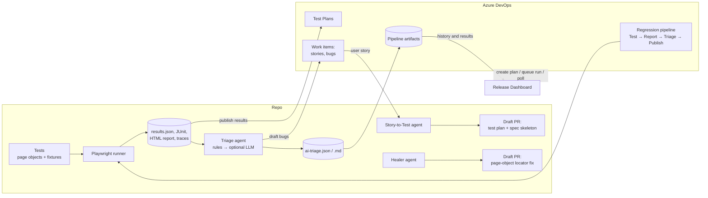

# ShopQA — Agentic AI Playwright Test Automation Framework

End-to-end test automation for the **ShopQA** e-commerce application (customer storefront, admin
panel and REST API), built with **Playwright + TypeScript** and integrated with **Azure DevOps**.

Besides the tests themselves, the project contains:

- **CI/CD pipelines** for Azure DevOps (PR checks, nightly sharded regression, release sign-off)
- **Azure Test Plans integration** (create a plan per release, publish results to Test Cases, draft bugs)
- **Failure Triage** that classifies every failed test as product bug / test issue / environment / flaky
- **AI agents** (story → tests, locator healer, Playwright IDE agents) that work **without an LLM**
  and can optionally use one later
- A **Release Dashboard** web app: enter a release version → plan created → pipeline runs → live
  progress → triaged results

No database is needed anywhere: state lives in Azure DevOps and JSON files.

---

## Table of contents

1. [The application under test](#1-the-application-under-test)
2. [What is in this repository](#2-what-is-in-this-repository)
3. [Prerequisites](#3-prerequisites)
4. [Installation (first time)](#4-installation-first-time)
5. [Configuration (.env and environments)](#5-configuration-env-and-environments)
6. [Running the tests](#6-running-the-tests)
7. [Reports, traces and debugging](#7-reports-traces-and-debugging)
8. [Writing new tests (conventions)](#8-writing-new-tests-conventions)
9. [Quality gates: lint, typecheck, unit tests, pre-commit](#9-quality-gates-lint-typecheck-unit-tests-pre-commit)
10. [Failure Triage](#10-failure-triage)
11. [Azure DevOps: Test Plans, results and bugs](#11-azure-devops-test-plans-results-and-bugs)
12. [Azure DevOps pipelines](#12-azure-devops-pipelines)
13. [AI agents](#13-ai-agents)
14. [LLM (optional)](#14-llm-optional)
15. [Release Dashboard](#15-release-dashboard)
16. [Docker and cloud browsers](#16-docker-and-cloud-browsers)
17. [Network mocking, visual and accessibility checks](#17-network-mocking-visual-and-accessibility-checks)
18. [All npm scripts](#18-all-npm-scripts)
19. [Troubleshooting](#19-troubleshooting)
20. [Further documentation](#20-further-documentation)

---

## 1. The application under test

| Part                          | URL                                          |
| ----------------------------- | -------------------------------------------- |
| Storefront + admin panel (UI) | https://nagendra-shopqa.netlify.app          |
| REST API                      | https://shopqa-backend.onrender.com          |
| API documentation (Swagger)   | https://shopqa-backend.onrender.com/api-docs |

Roles: **admin** and **customer**. The test accounts' credentials are provided by the team and go
into your local `.env` only (see [section 5](#5-configuration-env-and-environments)).

> The backend runs on a free hosting tier. The **first request after idle time can take 30–60 s**
> (cold start), and it can return 5xx errors under heavy parallel load. The framework keeps
> parallelism deliberately low for this reason.

---

## 2. What is in this repository



### Folder structure

```
├── tests/
│   ├── api/                  # API tests (admin, auth, cart, contract, orders, products, qa, reviews, users)
│   ├── ui/regression/        # UI regression tests (10 feature files)
│   ├── ui/sanity/            # UI smoke tests (@Sanity)
│   ├── ui/dashboard/         # Tests for the Release Dashboard itself
│   ├── e2e/                  # Cross-module journeys (customer + admin)
│   ├── setup/auth.setup.ts   # Logs in once per role and saves the session
│   └── seed.spec.ts          # Example test used by the Playwright AI agents
├── pages/                    # Page objects (one class per screen; admin/ and dashboard/ sub-folders)
├── api/                      # API clients, zod response schemas, TypeScript models
├── fixtures/                 # Playwright fixtures: data (API clients + test data), ui (page objects), api
├── test-data/                # Test data builders (users, addresses, images)
├── utils/                    # Request builder, API assertion helpers, PDF text reader
├── src/
│   ├── config/               # env.ts (validated configuration) + environments/<env>.env
│   ├── fixtures/             # Entry point for new tests: index.ts (+ asRole, a11y, network), dashboard.fixture.ts
│   ├── api/base.client.ts    # Base class for new API clients
│   ├── data/builders/        # More test data builders
│   └── utils/                # Logger with secret masking, custom expect matchers
├── ai/
│   ├── core/                 # LLM provider layer, redaction, guardrails, cost log, prompts, audit log
│   ├── rules/                # Deterministic triage rules + error signatures
│   ├── agents/               # Triage, Story-to-Test and Healer agents (+ CLIs)
│   ├── prompts/              # Versioned LLM prompt templates
│   └── evals/                # Golden samples + accuracy runner, deliberately broken demo suite
├── integrations/
│   ├── ado/                  # Azure DevOps REST client, Test Plans, results, work items, pipelines, repos
│   ├── report/               # Playwright JSON report parser
│   └── store/                # Store interface (JSON files today, swappable later)
├── dashboard/                # Release Dashboard: server/ (Express), web/ (React + Vite), shared/ contracts
├── .azuredevops/pipelines/   # Azure Pipelines YAML + templates
├── data/                     # JSON "stores": Test Case mapping, overrides, known issues, triage history
├── specs/                    # Markdown test plans written by agents (human reviewed)
├── docs/                     # Detailed guides, architecture, LEARNING.md
├── AGENTS.md, CLAUDE.md      # Rules for AI coding assistants (Copilot copy in .github/)
├── playwright.config.ts      # Main Playwright configuration
├── Dockerfile                # Runs the regression inside the official Playwright image
└── .env.example              # Every configuration variable, documented
```

### Test suites at a glance

| Suite                  | Folder                                   | Playwright project           | Tests                                  |
| ---------------------- | ---------------------------------------- | ---------------------------- | -------------------------------------- |
| API                    | `tests/api`                              | `api`                        | 181                                    |
| UI regression + sanity | `tests/ui/regression`, `tests/ui/sanity` | `chromium`, `firefox`        | 49 (+ seed) per browser                |
| End-to-end journeys    | `tests/e2e`                              | `e2e`                        | 5                                      |
| Role login setup       | `tests/setup`                            | `setup`                      | 2 (runs automatically before UI tests) |
| Release Dashboard      | `tests/ui/dashboard`                     | own config, desktop + mobile | 13 per device                          |

---

## 3. Prerequisites

| Tool                       | Version                 | Needed for                                                |
| -------------------------- | ----------------------- | --------------------------------------------------------- |
| **Node.js**                | 20 or newer (22 tested) | Everything                                                |
| **Git**                    | any recent              | Cloning, pre-commit hooks                                 |
| VS Code (recommended)      | latest                  | Editing; Playwright Test extension; Copilot/Claude agents |
| Docker Desktop             | optional                | `npm run docker:test`                                     |
| Azure DevOps project + PAT | optional                | Test Plans, pipelines, dashboard against real data        |

Check: `node -v` and `git --version`.

---

## 4. Installation (first time)

```bash
# 1. Get the code
git clone https://github.com/nagendrameesalapuri/UI_API_SHOPQA.git
cd UI_API_SHOPQA

# 2. Install dependencies (also installs the Git pre-commit hook)
npm ci

# 3. Install the browsers Playwright uses
npx playwright install --with-deps chromium firefox

# 4. Create your local configuration and fill in the credentials
cp .env.example .env            # Windows PowerShell: Copy-Item .env.example .env

# 5. Check that everything is wired correctly
npm run typecheck
npm run lint
npm run unit                    # ~115 fast unit tests, no browser, no network
npm run test:list               # lists all Playwright tests without running them

# 6. First real run against the application
npm run test:smoke
```

If step 5 or 6 complains about missing variables, the message lists exactly which ones to add to `.env`.

---

## 5. Configuration (.env and environments)

Configuration is loaded and **validated at start-up** by `src/config/env.ts`. If something is missing
or malformed, the run stops immediately with a readable list.

Values come from three places (first one wins):

1. Real environment variables (in pipelines: the Azure DevOps variable group)
2. `.env` in the project root — **your secrets, never committed** (it is in `.gitignore`)
3. `src/config/environments/<TEST_ENV>.env` — non-secret defaults (URLs) per environment, committed

### Minimum `.env` to run tests

```dotenv
TEST_ENV=qa

UI_TEST_ADMIN_EMAIL=...
UI_TEST_ADMIN_PASSWORD=...
UI_TEST_CUSTOMER_EMAIL=...
UI_TEST_CUSTOMER_PASSWORD=...
API_TEST_EMAIL=...          # customer account used by the API suite
API_TEST_PASSWORD=...
```

The application URLs (`UI_BASE_URL`, `API_BASE_URL`) come from `src/config/environments/qa.env`; you
only need them in `.env` to point at a different deployment.

### All variables

| Variable                                                                                     | Purpose                                                            | Default                        |
| -------------------------------------------------------------------------------------------- | ------------------------------------------------------------------ | ------------------------------ |
| `TEST_ENV`                                                                                   | `dev` / `qa` / `uat` — selects `src/config/environments/<env>.env` | `qa`                           |
| `UI_BASE_URL`, `API_BASE_URL`                                                                | Application URLs                                                   | from environment file          |
| `UI_TEST_ADMIN_EMAIL/PASSWORD`, `UI_TEST_CUSTOMER_EMAIL/PASSWORD`, `API_TEST_EMAIL/PASSWORD` | Test accounts                                                      | — (required)                   |
| `HEADLESS`                                                                                   | `true` = no visible browser locally                                | headed locally, headless in CI |
| `INCLUDE_QUARANTINE`                                                                         | `true` = also run tests tagged `@quarantine`                       | excluded                       |
| `LLM_PROVIDER`                                                                               | `none`, `azure-openai`, `anthropic`, `openai-compatible`           | `none`                         |
| `ADO_ORG`, `ADO_PROJECT`, `ADO_PAT`, `ADO_REPO`                                              | Azure DevOps access for local tools / dashboard                    | —                              |
| `ADO_REGRESSION_PIPELINE_ID`                                                                 | Pipeline queued by the dashboard; used for triage history          | —                              |
| `DASHBOARD_MOCK`, `DASHBOARD_USER`, `DASHBOARD_PASSWORD`, `DASHBOARD_PORT`                   | Release Dashboard                                                  | port 4300                      |
| `PLAYWRIGHT_SERVICE_URL`                                                                     | Optional Azure cloud browsers                                      | —                              |
| `TEAMS_WEBHOOK_URL`                                                                          | Optional triage summary to a Teams channel                         | —                              |

See `.env.example` for the complete, commented list (LLM keys, budgets, area/iteration paths, …).

---

## 6. Running the tests

### The everyday commands

```bash
npm run test:smoke        # quick health check: @Sanity UI tests + API smoke (chromium + api)
npm run test:api          # all API tests
npm run test:ui           # all UI tests on chromium AND firefox
npm run test:e2e          # end-to-end journeys
npm run test:regression   # everything tagged @Regression, all projects
npm test                  # absolutely everything
npm run test:dashboard    # tests of the Release Dashboard (no shop credentials needed)
```

Locally the browser opens **headed and maximised** so you can watch. Run headless with:

```bash
HEADLESS=true npm run test:ui                    # bash / Git Bash
$env:HEADLESS="true"; npm run test:ui            # PowerShell
```

### Running a subset

```bash
# One file
npx playwright test tests/ui/regression/CartTests.spec.ts

# One browser / project
npx playwright test --project=chromium
npx playwright test --project=api

# By title or tag (regular expression on the test title)
npx playwright test --grep "Apply coupon"
npx playwright test --grep @Regression --project=chromium
npx playwright test --grep-invert @E2E

# One test at a specific line
npx playwright test tests/api/cart/cart.spec.ts:55

# Repeat to check stability
npx playwright test tests/api/cart --repeat-each=3

# Only the tests that failed last time
npx playwright test --last-failed
```

### Tags used in test titles

| Tag                                              | Meaning                                                                                    |
| ------------------------------------------------ | ------------------------------------------------------------------------------------------ |
| `@Sanity` / `@smoke`                             | Quick health checks (`npm run test:smoke`)                                                 |
| `@Regression`                                    | Full regression set                                                                        |
| `@API`, `@E2E`, `@dashboard`, `@a11y`, `@visual` | Suite / type                                                                               |
| `@quarantine`                                    | Known flaky — **excluded** from all runs unless `INCLUDE_QUARANTINE=true`                  |
| `@TC-<id>`                                       | Linked Azure Test Case id (see [section 11](#11-azure-devops-test-plans-results-and-bugs)) |

Titles such as `TC-003` (without `@`) are local labels, not Azure ids.

### Playwright projects (from `playwright.config.ts`)

| Project    | What runs                   | Notes                                                     |
| ---------- | --------------------------- | --------------------------------------------------------- |
| `setup`    | `tests/setup/auth.setup.ts` | Logs in as admin and customer, saves sessions to `.auth/` |
| `chromium` | `tests/ui/**` + seed        | Depends on `setup`; dashboard tests excluded              |
| `firefox`  | same as chromium            |                                                           |
| `e2e`      | `tests/e2e`                 | 3-minute timeout per test                                 |
| `api`      | `tests/api`                 | 3 workers max (protects the backend)                      |

Locally: no retries. In CI (`TF_BUILD` or `CI` set): 2 retries, 1 worker per shard, `forbidOnly`.

---

## 7. Reports, traces and debugging

### Reports

| Where      | Report                                                                                     | How to open        |
| ---------- | ------------------------------------------------------------------------------------------ | ------------------ |
| Local      | HTML report in `playwright-report/`                                                        | `npm run report`   |
| Local + CI | `reports/results.json` (input for triage and Test Plans)                                   | any JSON viewer    |
| CI         | `reports/junit.xml` → Azure DevOps **Tests** tab; blob reports merged into one HTML report | pipeline artifacts |

Screenshots are taken **on failure**, videos are kept **on failure**, and traces are recorded **on the
first retry** (CI).

### Debugging a failing test

```bash
npx playwright test tests/ui/regression/CartTests.spec.ts --debug     # step through with the inspector
npx playwright test --ui                                               # interactive UI mode (watch, time-travel)
npx playwright show-trace test-results/<test-folder>/trace.zip         # open a recorded trace
npx playwright codegen https://nagendra-shopqa.netlify.app             # record actions to find locators
```

Each failed test folder in `test-results/` also contains `error-context.md` with the error and an
accessibility snapshot of the page — the healer agent uses this file.

---

## 8. Writing new tests (conventions)

The full rule set (also followed by AI assistants) is in [AGENTS.md](AGENTS.md). The essentials:

1. **Import `test` and `expect` from `src/fixtures`** in new specs.
   ```ts
   import { test, expect } from "../../../src/fixtures";
   ```
   Existing specs import from `fixtures/*` — both work; don't rewrite old specs unless asked.
2. **No raw locators in specs** — use page objects in `pages/`. Missing a method? Add it to the page object.
3. **Locator priority**: `getByRole` > `getByLabel` > `getByTestId` > `getByText` > CSS. No XPath.
4. **No `waitForTimeout`/sleeps.** Use web-first assertions or page-object `verify*()` methods.
5. **Each test creates its own data** through fixtures (fresh users, carts, orders) and is independent.
6. **Tag** the title (`@Regression`, `@TC-<id>` if mapped).

### Example

```ts
import { test, expect } from "../../../src/fixtures";
import { ProductListPage } from "../../../pages/ProductListPage";

test("@Regression signed-in customer can sort products by price", async ({ asRole }) => {
  const page = await asRole("customer"); // reuses the session saved by tests/setup
  const productListPage = new ProductListPage(page);

  await productListPage.navigateToProductListPage();
  await productListPage.sortBy("price_asc");

  expect(await productListPage.getDisplayedPrices()).toBeSorted("asc"); // custom matcher
});
```

For a test that needs its own fresh user and data, request data fixtures instead, e.g.
`async ({ verifiedUser, loginPage, cartPage }) => { … }` and log in with `verifiedUser.email`.
This is the same shape as `tests/seed.spec.ts`, which runs green against the live app.

### Fixtures you can ask for

| Fixture                                                                                                                                                                                                          | Gives you                                                |
| ---------------------------------------------------------------------------------------------------------------------------------------------------------------------------------------------------------------- | -------------------------------------------------------- |
| Page objects: `loginPage`, `registerPage`, `productListPage`, `productDetailPage`, `cartPage`, `checkoutPage`, `ordersPage`, `orderDetailPage`, `profilePage`, `wishlistPage`, `addressBookPage`, `admin*Page` … | Ready-to-use page objects                                |
| `adminPage`                                                                                                                                                                                                      | A second browser window already logged in as admin       |
| `asRole("admin" \| "customer")`                                                                                                                                                                                  | A new signed-in page for a role (uses the saved session) |
| API clients: `authApi`, `productApi`, `cartApi`, `orderApi`, `adminApi`, `userApi`, `wishlistApi`, `reviewApi`, `addressApi`, `qaApi`, `api` (fluent request builder)                                            | Typed API access                                         |
| Test data: `verifiedUser`, `pendingUser`, `secondUser`, `accessToken`, `adminAccessToken`, `userWithCart`, `checkoutCart`, `placedOrder`, `savedAddresses`, `lowStockProduct`, `outOfStockProduct`               | Data created through the API and cleaned up afterwards   |
| Cleanup lists: `productsToDeactivate`, `couponsToCleanUp`, `reviewsToDelete`                                                                                                                                     | Push ids; they are removed after the test                |
| `network`                                                                                                                                                                                                        | Mock / fail / abort / patch backend calls, HAR replay    |
| `a11y`                                                                                                                                                                                                           | Accessibility check (`await a11y.check()`)               |

Custom matcher example: `expect(prices).toBeSorted("asc")`.

---

## 9. Quality gates: lint, typecheck, unit tests, pre-commit

```bash
npm run lint          # ESLint (TypeScript + Playwright rules, catches missing `await`)
npm run lint:fix      # auto-fix what can be fixed
npm run typecheck     # TypeScript compiler, strict mode
npm run format        # Prettier
npm run unit          # Vitest unit tests for ai/, integrations/, dashboard server, src helpers
npm run eval:triage   # triage accuracy on the golden samples (must stay ≥ 90%)
```

A **pre-commit hook** (Husky) runs ESLint + Prettier on the staged files and the typecheck. If it fails,
fix the reported problem rather than bypassing the hook.

---

## 10. Failure Triage

After any test run, classify the failures:

```bash
npm run triage                                   # reads reports/results.json
npm run triage -- --results path/to/results.json --out reports
```

Output:

- `reports/ai-triage.md` — human summary: totals by category, **clusters** (one row per root cause),
  new vs. already-failing tests, flaky list, trace links
- `reports/ai-triage.json` — machine-readable (used by the dashboard and history)
- `data/triage-history.json` — last 30 runs, used to detect intermittent and persistent failures

Categories: **PRODUCT_BUG**, **TEST_ISSUE** (locator, test data, timing), **ENVIRONMENT** (network,
5xx, auth/config), **FLAKY**, **UNKNOWN** (needs a human). Each result has a confidence, a reason and the
id of the rule that decided it.

How it decides (no LLM needed):

1. Ordered rules in `ai/rules/triage-rules.ts` (e.g. `net::ERR_*` → ENVIRONMENT, strict mode violation →
   TEST_ISSUE, `Expected X / Received Y` on a found element → PRODUCT_BUG).
2. Known issues from `data/known-issues.json` override the rules.
3. History: a test that keeps flipping pass/fail becomes FLAKY; a failure with the same error for several
   runs gets higher PRODUCT_BUG confidence.
4. Only if an LLM is configured: one call per uncertain cluster, with redacted input.

Options: `--create-bugs` (draft bugs in Azure DevOps for PRODUCT_BUG clusters with confidence ≥ 0.8),
`--teams` (post to `TEAMS_WEBHOOK_URL`), `--history-from-ado 5` (load the previous 5 pipeline runs).

**Try it on the demo suite** (one deliberate failure of each kind, runs offline):

```bash
npx playwright test --config ai/evals/broken-suite/playwright.config.ts
npm run triage -- --results ai/evals/broken-suite/results.json --out reports/broken-demo --history reports/broken-demo/history.json
```

**Improve the rules:** add a row to `RULES` in `ai/rules/triage-rules.ts`, add a sample to
`ai/evals/golden/triage-golden.json`, run `npm run eval:triage`.

---

## 11. Azure DevOps: Test Plans, results and bugs

Setup once: put `ADO_ORG`, `ADO_PROJECT`, `ADO_PAT` (and `ADO_REPO` for agents) in `.env`.
PAT scopes: **Test Management** (read & write), **Work Items** (read & write), **Build** (read & execute),
**Code** (read & write).

### Step 1 — link tests to Test Cases

Either add `@TC-<id>` to the test title, or (without touching titles) add an entry to
`data/tc-overrides.json`:

```json
{ "ui/regression/CouponTests.spec.ts > Coupon Tests > @Regression TC-021 Apply FLAT500": 12345 }
```

Then:

```bash
npm run ado:map-tests                 # writes data/tc-mapping.json and lists unmapped tests
npm run ado:map-tests -- --plan 321   # also: Test Cases in plan 321 that have no automated test
```

### Step 2 — create the release Test Plan

```bash
npm run ado:create-plan -- --release 2026.10
```

Creates (or reuses) **"Regression 2026.10"** with one suite per feature folder and adds the mapped Test Cases.

### Step 3 — publish results

```bash
npm run test:regression
npm run ado:publish-results -- --plan 321        # or: --release 2026.10
```

Creates an automated test run, records outcome, duration, error, stack trace and failure screenshot
for each Test Case, then completes the run. In pipelines this happens automatically.

Details: [docs/how-to-ado.md](docs/how-to-ado.md).

---

## 12. Azure DevOps pipelines

Files in `.azuredevops/pipelines/`:

| Pipeline               | When                                                       | Does                                                                   |
| ---------------------- | ---------------------------------------------------------- | ---------------------------------------------------------------------- |
| `pr-validation.yml`    | Every pull request to `main`                               | Lint, typecheck, unit tests, triage eval, dashboard tests, smoke tests |
| `regression.yml`       | Nightly 02:00 IST (Mon–Fri), manual, or from the dashboard | Sharded regression → merged report → triage → publish to Test Plan     |
| `release-run.yml`      | Manual, release version required                           | Same as regression for a release sign-off                              |
| `ai-story-to-test.yml` | Manual with a story id                                     | Runs the Story-to-Test agent                                           |

Regression parameters: `environment` (dev/qa/uat), `grep` (default `@Regression`), `shards` (default 4),
`releaseVersion`, `testPlanId`, `createBugs`, `runInContainer`.

Setup summary (full guide with screenshots-level steps: [docs/how-to-pipelines.md](docs/how-to-pipelines.md)):

1. Create variable groups `playwright-qa` (and `-dev`, `-uat`) with the test-account secrets, ideally
   linked to Azure Key Vault, plus `playwright-ai` with `LLM_PROVIDER=none`.
2. Create one pipeline per YAML file (_Pipelines → New pipeline → Existing YAML file_).
3. Grant the _Project Build Service_ permissions for Test Plans, Work Items and Repos.
4. Validate with _Edit → ⋮ → Validate_.

Artifacts per run: `html-report`, `results-json`, `ai-triage` (summary also shown on the run page).

---

## 13. AI agents

All agents work with **no LLM**. They only create branches, **draft** pull requests, Test Cases and
**draft** bugs — they never merge, delete or close anything. Every action is logged in
`reports/agent-audit.jsonl`.

### Story-to-Test — turn a user story into tests

```bash
# Offline demo with a sample story
npm run agent:story -- --story-file ai/evals/fixtures/story-1234.json --dry-run

# Real story from Azure DevOps: only write files locally
npm run agent:story -- --id 1234 --dry-run

# Real story: create Test Cases, push branch ai/story-1234 and open a draft PR
npm run agent:story -- --id 1234 --create-test-cases
```

Produces `specs/story-<id>.md` (scenario plan from the acceptance criteria) and
`tests/ui/stories/story-<id>.spec.ts` (a compiling skeleton: one `test.fixme` per scenario, one step per
Given/When/Then, with suggested page-object methods). A human then implements the steps.

### Healer — fix broken locators in page objects

```bash
npm run triage                    # needs reports/ai-triage.json
npm run agent:heal -- --dry-run   # proposes and validates fixes, prints the diff, changes nothing
npm run agent:heal                # applies; opens a draft PR when Azure DevOps is configured
```

Only for failures classified TEST_ISSUE/locator. It changes **only the locator line in a page object**,
re-runs the failing test and keeps the change only if the test passes (max 2 attempts). It never
touches specs or assertions.

### Playwright Test Agents in your editor

Planner, generator and healer agents are installed for **VS Code (Copilot)** in `.github/agents/` and for
**Claude Code** in `.claude/agents/`, using `tests/seed.spec.ts` as the example. In the chat, pick the
agent and ask e.g. _"Plan tests for the wishlist page"_. Guide: [docs/how-to-playwright-agents.md](docs/how-to-playwright-agents.md).

---

## 14. LLM (optional)

Nothing requires an LLM. When your company approves one, set in `.env` (or the `playwright-ai` group):

```dotenv
LLM_PROVIDER=azure-openai      # or anthropic / openai-compatible
AZURE_OPENAI_ENDPOINT=...
AZURE_OPENAI_DEPLOYMENT=...
AZURE_OPENAI_API_KEY=...
LLM_BUDGET_USD=1.00            # per run
```

Safety built in: personal data and secrets are **redacted** before sending, inputs truncated,
per-run limits on calls and cost, every call logged to `reports/ai-usage.jsonl`, and any LLM failure falls
back to the rule-based result. Guide: [docs/how-to-llm.md](docs/how-to-llm.md).

---

## 15. Release Dashboard

A web page where a release manager enters a release version and follows the run.

### Try it locally with sample data (no Azure DevOps needed)

```bash
DASHBOARD_MOCK=true npm run dashboard:dev               # bash / Git Bash
$env:DASHBOARD_MOCK="true"; npm run dashboard:dev       # PowerShell
```

Open **http://localhost:4300**, type `2026.10.1`, click **Start regression run** and watch the steps:
Test Plan created → Pipeline queued → Running (4 shards) → Reports merged → Failures triaged → Results
published, then the results (KPI tiles, failures by category / by root cause). Also see the **Trend**
and **Releases** tabs.

### Against real Azure DevOps

Add to `.env`: `ADO_ORG`, `ADO_PROJECT`, `ADO_PAT`, `ADO_REGRESSION_PIPELINE_ID`, `DASHBOARD_USER`,
`DASHBOARD_PASSWORD`, then:

```bash
npm run ado:map-tests
npm run dashboard:build
npm run dashboard:start        # http://localhost:4300 (basic auth)
```

The PAT stays on the server; the browser never sees it. Hosting (Azure App Service / container) and
sign-in options: [docs/how-to-dashboard.md](docs/how-to-dashboard.md).

---

## 16. Docker and cloud browsers

```bash
npm run docker:test                                        # build the image and run the regression in it
npm run docker:test -- npx playwright test --project=api   # any command inside the container
```

Uses `mcr.microsoft.com/playwright:v1.63.0-noble` (same version as `@playwright/test`), runs as a
non-root user, reads secrets from `.env` at run time and writes reports to `./reports`.

Optional **Azure Playwright Workspaces** (browsers in the cloud, many parallel workers):
`npx playwright test --config=playwright.service.config.ts` with `PLAYWRIGHT_SERVICE_URL` set and `az login`.
Guide: [docs/how-to-cloud-browsers.md](docs/how-to-cloud-browsers.md).

---

## 17. Network mocking, visual and accessibility checks

```ts
test("cart shows an error when the API is down", async ({ network, cartPage }) => {
  await network.fail(/\/api\/cart$/, 503);
  await cartPage.navigateToCartPage();
  // assert the error message through the page object
});

test("@a11y checkout has no serious accessibility issues", async ({ a11y, checkoutPage }) => {
  await checkoutPage.navigateToCheckoutPage();
  await a11y.check(); // WCAG 2 A/AA, fails on serious/critical, full report attached
});
```

Visual checks use `await expect(page).toHaveScreenshot()`; generate baselines **inside Docker** so they
match CI. Examples incl. HAR record/replay: [docs/how-to-network-visual-a11y.md](docs/how-to-network-visual-a11y.md).

---

## 18. All npm scripts

| Script                                        | Description                                   |
| --------------------------------------------- | --------------------------------------------- |
| `npm test`                                    | All Playwright projects                       |
| `npm run test:smoke`                          | `@Sanity`/`@smoke` on chromium + api          |
| `npm run test:regression`                     | `@Regression` on all projects                 |
| `npm run test:api`                            | API suite                                     |
| `npm run test:ui`                             | UI suite on chromium + firefox                |
| `npm run test:e2e`                            | End-to-end journeys                           |
| `npm run test:dashboard`                      | Release Dashboard UI tests                    |
| `npm run test:list`                           | List tests without running                    |
| `npm run report`                              | Open the last HTML report                     |
| `npm run lint` / `lint:fix`                   | ESLint                                        |
| `npm run format` / `format:check`             | Prettier                                      |
| `npm run typecheck`                           | TypeScript compiler check                     |
| `npm run unit` / `unit:watch`                 | Vitest unit tests                             |
| `npm run triage`                              | Classify failures from `reports/results.json` |
| `npm run eval:triage`                         | Triage accuracy on golden samples             |
| `npm run ado:map-tests`                       | Map tests ↔ Azure Test Cases                  |
| `npm run ado:create-plan -- --release <v>`    | Create/reuse release Test Plan                |
| `npm run ado:publish-results -- --plan <id>`  | Publish results to a Test Plan                |
| `npm run agent:story -- --id <id>`            | Story-to-Test agent                           |
| `npm run agent:heal`                          | Healer agent                                  |
| `npm run dashboard:dev`                       | Dashboard with hot reload                     |
| `npm run dashboard:build` / `dashboard:start` | Build / serve the dashboard                   |
| `npm run docker:build` / `docker:test`        | Docker image / run inside it                  |

---

## 19. Troubleshooting

| Problem                                                   | Solution                                                                                                        |
| --------------------------------------------------------- | --------------------------------------------------------------------------------------------------------------- |
| `Invalid or missing environment variables: …`             | Copy `.env.example` to `.env` and fill in the listed variables                                                  |
| Many API tests fail with 5xx or time out on the first run | Backend cold start: open https://shopqa-backend.onrender.com once, wait a minute, rerun                         |
| `Executable doesn't exist at …chromium…`                  | `npx playwright install --with-deps chromium firefox`                                                           |
| UI tests fail at the `setup` step                         | Check the admin/customer credentials in `.env`; the account may be locked after 5 wrong passwords (wait 30 min) |
| `Azure DevOps is not configured. Missing: …`              | Add `ADO_ORG`, `ADO_PROJECT`, `ADO_PAT` to `.env`, or run without ADO options                                   |
| Dashboard: port 4300 or 4310 already in use               | Set `DASHBOARD_PORT`, or stop the other process                                                                 |
| Pre-commit hook fails                                     | Run `npm run lint` and `npm run typecheck`, fix the errors, commit again                                        |
| Screenshot comparisons fail on another machine            | Baselines must be created in Docker (fonts differ between operating systems)                                    |
| Triage marks many failures UNKNOWN                        | Add a rule row + golden sample (see [section 10](#10-failure-triage))                                           |
| `npm ci` fails with lock-file errors                      | Use Node 20+; delete `node_modules` and run `npm ci` again                                                      |

---

## 20. Further documentation

| Document                                                                 | Content                                                                           |
| ------------------------------------------------------------------------ | --------------------------------------------------------------------------------- |
| [AGENTS.md](AGENTS.md)                                                   | Coding rules for humans and AI assistants                                         |
| [docs/architecture.md](docs/architecture.md)                             | Design, decisions and trade-offs, security                                        |
| [docs/LEARNING.md](docs/LEARNING.md)                                     | TypeScript/Playwright/Azure DevOps concepts explained for Java/Serenity engineers |
| [docs/how-to-pipelines.md](docs/how-to-pipelines.md)                     | Creating pipelines, variable groups, Key Vault, permissions                       |
| [docs/how-to-ado.md](docs/how-to-ado.md)                                 | PAT scopes, Test Case mapping, Test Plans, results, bugs                          |
| [docs/how-to-llm.md](docs/how-to-llm.md)                                 | Enabling an LLM later, guardrails, privacy                                        |
| [docs/how-to-dashboard.md](docs/how-to-dashboard.md)                     | Running and hosting the Release Dashboard                                         |
| [docs/how-to-playwright-agents.md](docs/how-to-playwright-agents.md)     | IDE agents, Story-to-Test, Healer                                                 |
| [docs/how-to-cloud-browsers.md](docs/how-to-cloud-browsers.md)           | Azure Playwright Workspaces                                                       |
| [docs/how-to-network-visual-a11y.md](docs/how-to-network-visual-a11y.md) | Mocking, HAR, screenshots, accessibility, quarantine                              |
| [docs/self-review.md](docs/self-review.md)                               | Known weaknesses, risks, next improvements                                        |
