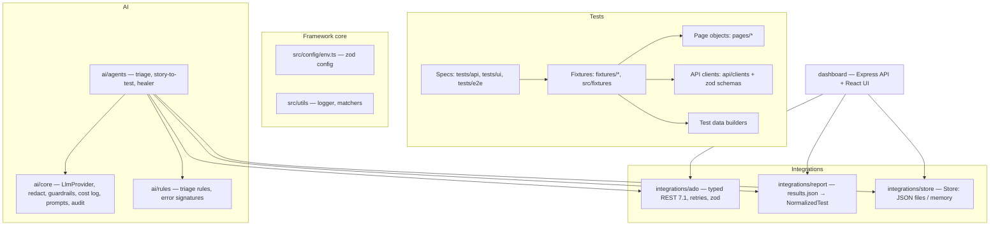

# Architecture, decisions and trade-offs

## Layers

Dependency direction: tests → fixtures → page objects/clients. `ai/` and `dashboard/` depend on
`integrations/`, never the other way round. Target-specific code (shop app) lives only in `pages/`,
`api/`, `fixtures/`, `test-data/`, `tests/` and `src/config/environments/`.

## Decisions

| Decision                                                                                 | Why                                                                                                                                                                                     | Trade-off                                                                       |
| ---------------------------------------------------------------------------------------- | --------------------------------------------------------------------------------------------------------------------------------------------------------------------------------------- | ------------------------------------------------------------------------------- |
| Kept the existing `pages/`, `api/`, `fixtures/` folders instead of moving them to `src/` | They are working, reviewed code; moving 8k lines adds risk and churn for no behaviour change. `src/fixtures/index.ts` gives new specs the single entry point the Master Prompt asks for | Two fixture entry points coexist until old specs are migrated                   |
| Existing tags kept (`@Sanity` = smoke, `@Regression`, `@API`, `@E2E`)                    | Renaming test titles breaks history and Test Case mapping                                                                                                                               | `test:smoke` greps `@Sanity                                                     | @smoke` |
| `fullyParallel: false`, 1 CI worker, shards across agents                                | The free-tier backend returns 5xx under concurrent load                                                                                                                                 | Slower per agent; scale out with more shards                                    |
| Rules first, LLM second                                                                  | Works today with no LLM; deterministic, testable (23-sample eval); LLM only for uncertain clusters → low cost                                                                           | Rules need maintenance as new failure patterns appear                           |
| One LLM call per error **cluster**, not per test                                         | 30 tests failing on one 503 = one root cause = one call                                                                                                                                 | A wrong cluster answer affects all its tests                                    |
| No database: ADO + JSON files behind `Store`                                             | Zero infrastructure; ADO already stores plans, runs, artifacts                                                                                                                          | History is rebuilt from artifacts (N downloads per triage); caches are per host |
| Triage history from previous pipeline artifacts (`--history-from-ado 5`)                 | Pipeline workspaces are ephemeral; artifacts are durable                                                                                                                                | Adds ~5 artifact downloads per run                                              |
| REST instead of `azure-devops-node-api`                                                  | Small surface, typed with zod, mockable `fetch`, explicit retries                                                                                                                       | We maintain the endpoint list ourselves                                         |
| Official `@anthropic-ai/sdk` for Anthropic, `fetch` for Azure OpenAI / OpenAI-compatible | SDK handles retries/types; the others are a single endpoint                                                                                                                             | Two code paths                                                                  |
| Agents open **draft** PRs via REST pushes (no local git)                                 | Works in any pipeline without credentials helpers; nothing is merged automatically                                                                                                      | Large files are sent as JSON                                                    |
| Healer edits page objects only, one locator line, re-run must pass                       | Prevents "healing" by weakening assertions                                                                                                                                              | Raw locators in specs are not healed (by design)                                |
| Dashboard: Express + React/Vite, hash routing, shared zod contracts                      | Same language both sides; contracts validated on both ends; no router dependency                                                                                                        | Basic auth only (Entra ID via App Service Easy Auth recommended in production)  |
| Separate Playwright config for the dashboard                                             | No shop credentials needed; builds and serves its own web app                                                                                                                           | Two configs to maintain                                                         |
| Docker image pinned to the Playwright version                                            | Identical browsers/fonts for visual baselines and CI                                                                                                                                    | Must bump Dockerfile + package.json together                                    |

## Data flow of a release run

1. Dashboard `POST /api/runs` → `createReleasePlan` (idempotent) → `ensureSuites` + `addTestCases` from
   `data/tc-mapping.json` → `queueRun(regression, { releaseVersion, testPlanId, environment, grep })`.
2. `regression.yml`: N shards run tests, publish JUnit + blob reports → merge to HTML + `results.json`
   → triage (rules, history from previous artifacts, optional LLM, optional draft bugs) → publish to Test Plan.
3. Dashboard polls the run + timeline every 15 s and, once triaged, reads `ai-triage.json` from the
   artifact (cached forever in `dashboard/.cache` because completed runs never change).

## Security

- Secrets only from env / Key Vault-linked variable groups; `.env` is gitignored; logs mask tokens.
- The PAT stays on the dashboard server; the browser never sees it. Real mode refuses to start
  without `DASHBOARD_USER`/`DASHBOARD_PASSWORD`.
- LLM input is redacted (emails, phones, JWT/bearer/API keys, secrets, VINs, registrations, configured
  names) and truncated; usage and cost are logged; guardrails cap calls and budget per run.
- Agent permissions: branches, draft PRs, Test Cases, draft bugs. Every action is audited.
